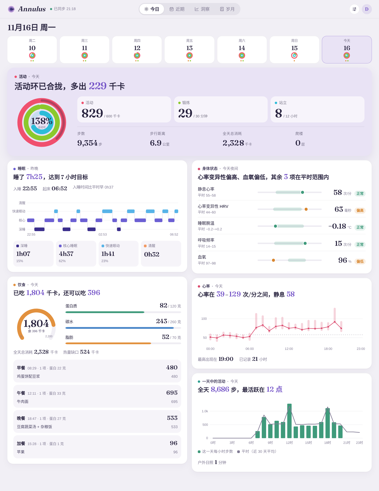
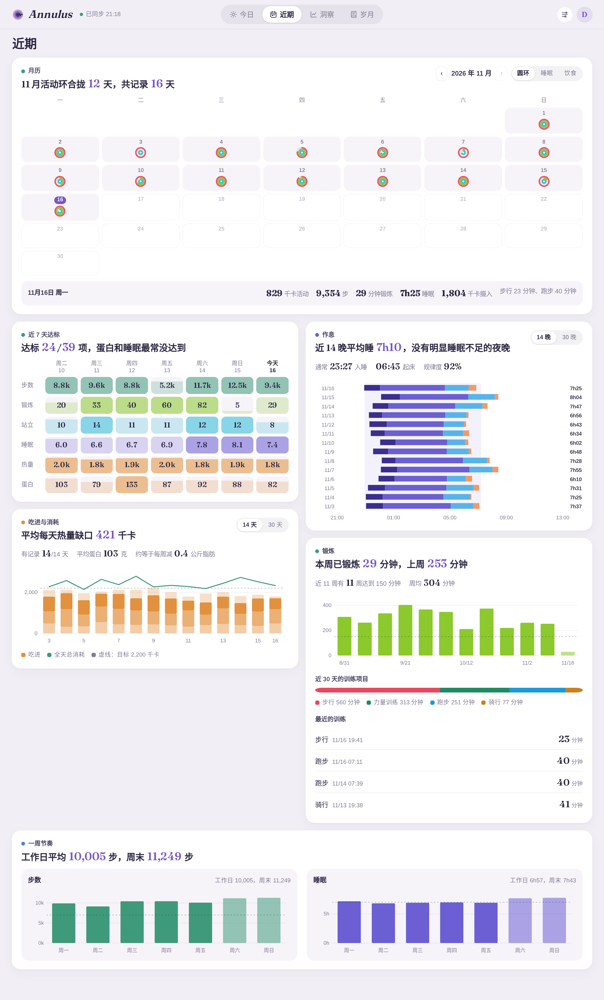
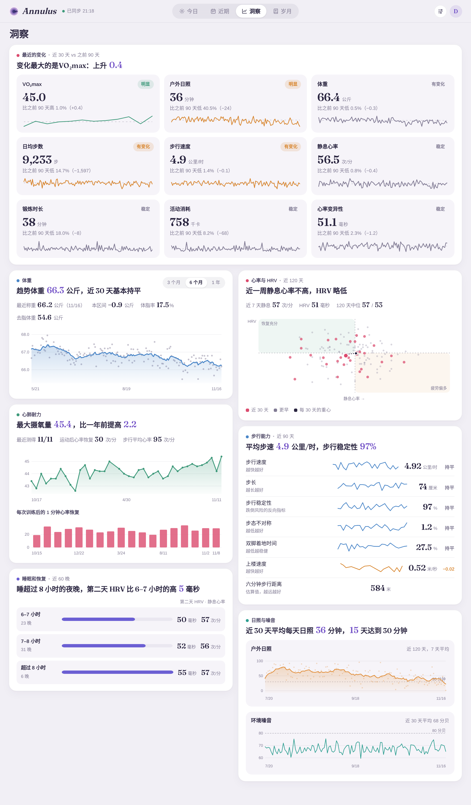
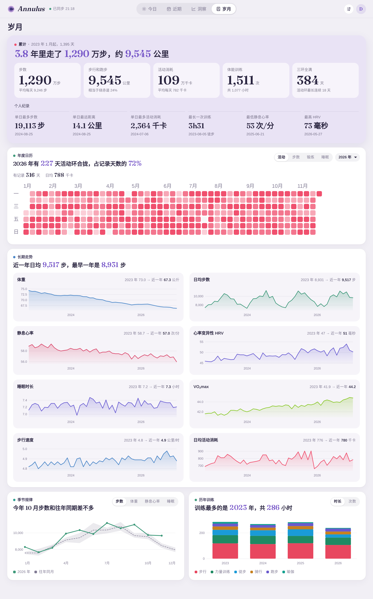

# Annulus

> Copied with permission from [pku-zhb/annulus](https://github.com/pku-zhb/annulus)
> (commit ccdc626) by [pku-zhb](https://github.com/pku-zhb), MIT license.
> The original repository is the place for updates and issues.
> To run this copy: `cd projects/annulus && python3 serve.py`.

Annulus is an unofficial, personal web dashboard for a self-hosted
[Marrow](https://marrowhealthapp.com) server (an Apple Health mirror). It is
not affiliated with or endorsed by Marrow.

The Marrow iPhone app mirrors Apple Health to a server I run at home. A small
sync job copies that mirror into InfluxDB, and Annulus reads from it:
activity rings, sleep stages, heart rate and HRV, weight, workouts, and a food
diary, organised into four tabs:

| Tab | What it shows |
| --- | --- |
| **今日** (Today) | rings, last night's sleep, vitals against a 30-day baseline, food diary, hourly heart rate and steps |
| **近期** (Recent) | month calendar, last 7 days, bed/wake times, intake vs. burn, workouts, weekday rhythm |
| **洞察** (Insights) | 30-day vs. prior-90-day changes, weight trend, VO₂max, HR × HRV, walking metrics, daylight and noise |
| **岁月** (Years) | lifetime totals and records, year heatmap, long-term trends, seasonality, workouts by year |

> **Candid note.** This is a quick, vibe-coded personal frontend. It was put
> together for my own use and has not been carefully tuned, tested across
> devices, or hardened for anyone else. Treat it as a sketch of what you can
> build on a Marrow mirror, not a product. The UI text is in Chinese.

Everything in this repository runs on **synthetic demo data**. No real health
data, accounts, or server details are included.

## Screenshots

Demo data, light theme, 1280 px wide.

| 今日 Today | 近期 Recent |
| --- | --- |
|  |  |
| **洞察 Insights** | **岁月 Years** |
|  |  |

## Run it

Python 3.9+ only; no dependencies.

```sh
git clone https://github.com/pku-zhb/annulus.git
cd annulus
python3 serve.py            # then open http://127.0.0.1:8800
```

Demo mode has no login: the page loads straight into the dashboard. "Log out"
and the login form are wired to stubs that always succeed, and password change
is disabled.

## Layout

```
public/                      the frontend: index.html, app.js, theme.css, icons, Fraunces font
serve.py                     stdlib demo server: static files + /api/ui/overview from the fixture
demo/generate.py             builds the synthetic dataset and runs it through the real payload builder
demo/overview.json           the generated fixture (committed)
annulus/overview.py          payload builder used in the real setup (InfluxDB → one JSON payload)
scripts/screenshots.py       regenerates docs/screenshots (needs `pip install playwright`)
```

The frontend is plain JavaScript with hand-rolled SVG charts, no build step and
no framework. It makes one request, `GET /api/ui/overview`, and renders every
tab from that single payload. Card order and visibility are saved in
`localStorage`.

### Regenerate the demo data

```sh
python3 demo/generate.py                          # anchored at 2026-11-16 21:30, fixed seed
python3 demo/generate.py --today 2027-03-01 --seed 7
```

The generator produces about four years of daily data for a fictional person
(seasonal step counts, weekly workout rhythm, slowly improving resting heart
rate and VO₂max, a gentle weight trend, sleep with stage segments, hourly
heart rate, and a made-up food diary), then feeds it through
`annulus/overview.py` via an in-memory stand-in for InfluxDB, so the
fixture matches what the real backend serves.

### Using it with a real Marrow server

In my own setup the same routes sit inside a gateway in front of the Marrow
server, with a password login (scrypt hash, HttpOnly session cookie, CSRF
token, origin check), and the overview is built from InfluxDB that a sync job
fills from the Marrow mirror. Those deployment-specific pieces are not part of
this repo. To wire up your own, serve `public/` and answer
`GET /api/ui/overview` with a payload shaped like `demo/overview.json`;
`overview.py` shows how it is assembled from daily, hourly, sample, meal and
workout points. Auth is optional and up to you.

## License

MIT, see [LICENSE](LICENSE). The bundled Fraunces font is under the SIL Open
Font License 1.1 (`public/vendor/fraunces-OFL.txt`). Marrow is a separate app
by its own developer; Annulus is an unofficial personal frontend and is not
affiliated with Marrow.
