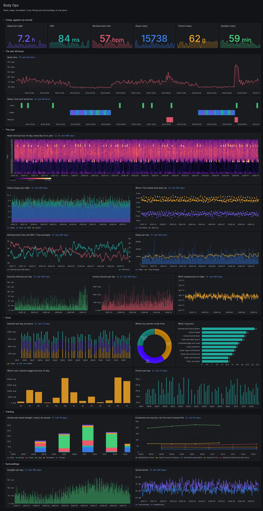

# Body Ops

Every signal your phone, watch and logs collect, on one Grafana dashboard that updates itself every hour: a year of heart rate by the hour, sleep stages and bed and wake times, resting heart rate and HRV, steps and exercise, food by macro and by meal, training volume by muscle and estimated one rep maxes, daylight and sound.



*The picture shows demo data from `tools/demo.py`, not a real person.*

[Marrow Health](https://marrowhealthapp.com) sends the data. Its Automations post your Apple Health metrics, raw heart rate and sleep stages, workouts, strength log and food diary as JSON on a schedule, from the phone, with the app closed. A small bridge here writes them into InfluxDB, and Grafana draws them. Everything runs on your own machine.

```
iPhone (Marrow) --HTTPS--> bridge --> InfluxDB 2 --> Grafana
```

## What you need

- **Marrow on your iPhone.** Body Ops uses six automations. The free plan runs one connection at a time (pick "Body daily" below and the year charts fill in). Marrow Pro runs up to ten.
- **A machine with Docker that stays on**: a home server, NAS, Raspberry Pi 4 or 5, or a small VPS. About 1 GB of memory.
- **A public HTTPS address for the bridge**, so your phone can reach it from anywhere. Three ways are below.

## 1. Start it

```sh
git clone https://github.com/MarrowHealth/built-with-marrow.git
cd built-with-marrow/projects/body-ops
cp .env.example .env
```

Fill in `.env`. Each secret should be long and random, for example `openssl rand -hex 32`. Set `TZ_NAME` to your time zone (`America/New_York`, `Europe/London`).

```sh
docker compose up -d
```

Open http://localhost:3000 and sign in as `admin` with your `GRAFANA_PASSWORD`. Body Ops is the home dashboard. Type your time zone into the **Time zone** box at the top, so days and hours line up with yours.

## 2. Try it with demo data (optional)

```sh
python3 tools/demo.py --token <your BRIDGE_TOKEN> --tz America/New_York
```

A year of made-up data goes through the bridge in the same shapes Marrow sends. To clear it before connecting your phone: `docker compose down -v && docker compose up -d` (this deletes everything stored).

## 3. Give the bridge an address

The bridge listens on `127.0.0.1:8799`. Pick one:

- **Cloudflare Tunnel** (a domain on Cloudflare): create a tunnel in the Cloudflare dashboard (Zero Trust, Networks, Tunnels), add a public hostname that points to `http://bridge:8799`, put its token in `TUNNEL_TOKEN`, then `docker compose --profile tunnel up -d`.
- **Tailscale Funnel** (no domain needed): on the same machine, `tailscale funnel --bg 8799`. Your address is `https://<machine>.<tailnet>.ts.net`.
- **Your own reverse proxy** (Caddy, nginx, Traefik) with HTTPS in front of port 8799.

Check it from anywhere:

```sh
python3 tools/selftest.py --url https://<your-bridge-host> --token <your BRIDGE_TOKEN>
```

Six "ok" lines mean the bridge, InfluxDB and the address all work. The test points are dated 2001, so they never show up in a normal range.

## 4. Connect Marrow

In Marrow, open **Export**, turn on **Automated**, then **Connections**, **InfluxDB**. Paste your address with the token on the end, `https://<your-bridge-host>/<BRIDGE_TOKEN>`, and leave the header empty. Set the format to **JSON**, every **1 hour**, and under **More options** a timeout of **300 s**.

Make six automations. Set up the first, then use **Duplicate automation** for the rest:

| Name | Data type | Under More options |
|---|---|---|
| Body daily | Health metrics, Metrics: All | Last year, Daily totals |
| Body samples | Health metrics, Metrics: All | Last 30 days, Raw samples |
| Body workouts | Workouts | Last year |
| Body strength | Strength log | Last year |
| Body food | Nutrition diary | Last year |
| Body mood | Symptoms and mood | Last year |

Tap **Run now** on each and wait for **Delivered**, then switch every date range to **Since last run**. From then on each run sends only what is new, from the phone, in the background.

Raw samples are big: about 70,000 readings and 8 MB for every month of history. More than 90 days of every metric in one run is too much for the phone. For a full year of heart rate (the heatmap), duplicate "Body samples", tap **Metrics**, **None**, then **Heart rate**, choose **Last year**, run it once, and delete it.

## What is on it

| Section | Panels |
|---|---|
| Today | sleep last night, HRV, resting heart rate, steps, protein, daylight, each with its 30 day trend |
| The last 48 hours | heart rate, and a timeline of every sleep stage and workout |
| The year | heart rate by hour of day for every day, sleep stages per night, bed and wake times, resting heart rate and HRV, steps, exercise minutes, active calories, wrist temperature |
| Food | calories by macro per day, where calories come from, most logged foods, calories by meal, protein per day |
| Training | weekly volume by muscle, estimated one rep max for your five most trained lifts |
| Surroundings | daylight, environmental and headphone sound levels |

## How it works

The bridge (`bridge/bridge.py`, standard library Python) accepts every automation kind, keeps a gzip copy of each delivery in the `archive` volume, answers at once and writes in the background. It refuses CSV (pick JSON), cut-off uploads, and any address without your token.

| Marrow sends | InfluxDB measurement | Tags | Time |
|---|---|---|---|
| Health metrics, daily totals | `daily` | metric, units | noon UTC of the day |
| Health metrics, raw samples | `sample` | metric, units, stage, source | sample start |
| Workouts | `workout` | activity, source | start |
| Strength log | `set` | exercise, muscle, session, set_type, unit, n | set time |
| Nutrition diary | `meal` (name in `food`, nutrients as `n_*`) | day, idx, meal | logged time (see below) |
| Symptoms and mood | `symptom`, `mood` | name and severity, kind | start or time |

A delivery only counts as done once its points are in InfluxDB, and the bridge records that in `archive/processed.log`. If it stops in between (a crash, a restart, InfluxDB down), the next start writes every unfinished delivery, oldest first, before anything new, so a newer snapshot of a food day always lands last. While InfluxDB is unreachable it waits and retries in order. `python3 tools/test_recovery.py` kills the bridge in both bad moments (before a write lands, and after it lands but before it is marked done, so it gets written twice) and checks that the final points match a run that was never interrupted, with a newer food snapshot queued behind (no Docker needed). The first start after upgrading from a version without `processed.log` writes the whole archive once, which is safe.

Marrow re-sends the last two days on every "Since last run" on purpose, so the bridge treats every point as latest-wins, and a food day is cleared and rewritten so deleted entries disappear. Each set is tagged with its main muscle from `bridge/muscles.json`, built from the public domain [free-exercise-db](https://github.com/yuhonas/free-exercise-db).

A meal's time is when it was logged, and Marrow uses a default time for each meal (breakfast 8 am, lunch noon, dinner 6 pm) when you log into a meal rather than as you eat. So the dashboard groups food by meal and by day, never by the clock.

To rebuild InfluxDB from the archive: `docker compose exec bridge python3 /app/bridge.py replay`.

## Make it yours

The dashboard is generated by `dashboard/overview.py` (Python, standard library). Edit it and run `python3 overview.py` to rewrite `grafana/dashboards/body-ops.json`, or edit panels in Grafana and save a copy. The Flux queries are good starting points for your own panels: every one reads from the `health` bucket in the measurements above.

## Privacy

Your data stays on your machine: the bridge, InfluxDB and Grafana all run there, and nothing here calls out anywhere else. Grafana and InfluxDB listen on localhost only. Keep it that way, or put them behind a login, before you open them to a network.

## Troubleshooting

- **Marrow says "Server answered 404"**: the token at the end of the address does not match `BRIDGE_TOKEN`.
- **"Server answered 415"**: the automation's format is CSV. Pick JSON.
- **Panels say No data**: check the Time zone box, widen the time range, and look at `docker compose logs bridge` for one line per delivery.
- **The first raw samples run times out**: use a shorter range (Last 30 days), or raise the timeout to 300 s.

MIT license. Part of [Built with Marrow](../../README.md).
