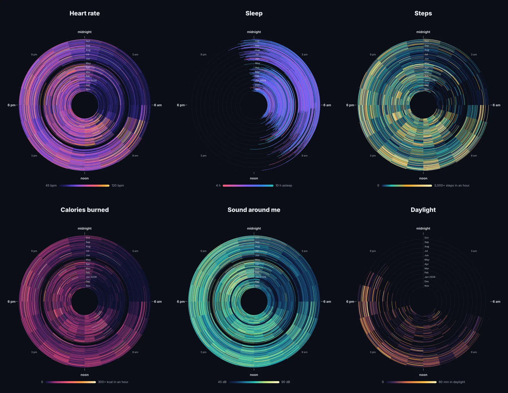

# A Year in Rings

One picture of a year. Six clock rings: one ring per day, oldest in the middle; one slice per hour, midnight at the top; the color is that hour's value.



*A real year, drawn by running this code on the author's own data.*

| Ring | What it shows | From |
|---|---|---|
| Heart rate | average beats per minute that hour | raw heart rate samples |
| Sleep | one arc per night, from falling asleep to waking up, colored by how long it was | nightly sleep totals |
| Steps | steps that hour | raw step samples |
| Calories burned | active energy that hour | raw active energy samples |
| Sound around me | average decibels that hour | raw environmental sound samples |
| Daylight | minutes in daylight that hour | raw daylight samples |

Sleep shows up on its own in the heart rate ring as the dark band around midnight. Daylight is widest in the summer rings and narrowest in winter.

## What you need

- **[Body Ops](../body-ops)** running: Marrow's automations feed its InfluxDB, and this script reads from it. Any InfluxDB that holds the bridge's `sample` and `daily` measurements works.
- **A year of raw samples** for the five hourly rings. Body Ops keeps 30 days of them, so run one more export: in Marrow, duplicate "Body samples", tap **Metrics**, **None**, then pick **Heart rate, Step count, Active energy, Environmental sound exposure** and **Time in daylight**, choose **Last year**, run it once and delete it. Around 300,000 readings and 30 MB, a few minutes on the phone. A metric with no samples is left out; one that starts late gets a smaller ring.
- Python 3.9 or newer, nothing to install.

## Run it

```sh
python3 rings.py --token <your INFLUX_TOKEN> --tz America/New_York
```

It writes `out/rings.html` with your data inside. Open it in a browser and press **Download PNG** for the 3000 by 2320 picture. With Playwright installed (`pip install playwright && playwright install chromium`) it writes `out/rings.png` for you.

Options: `--days 180` for a shorter span, `--url` and `--org` for an InfluxDB that is not Body Ops' default (`http://127.0.0.1:8086`, org `marrow`).

## Make it yours

The six charts are a list at the top of `rings.html`: a title, the metric, the color stops and the legend ends. Change a scale, drop a ring, or add one for any metric Marrow samples (`respiratory_rate`, `headphone_audio_exposure`, `walking_speed`). `rings.py` has the matching list of metrics and how each adds up within an hour (sum for counts, mean for rates).

## Privacy

The script talks only to your InfluxDB. The page it writes contains your data, so share the PNG, not the HTML, unless you mean to.

MIT license. Part of [Built with Marrow](../../README.md).
